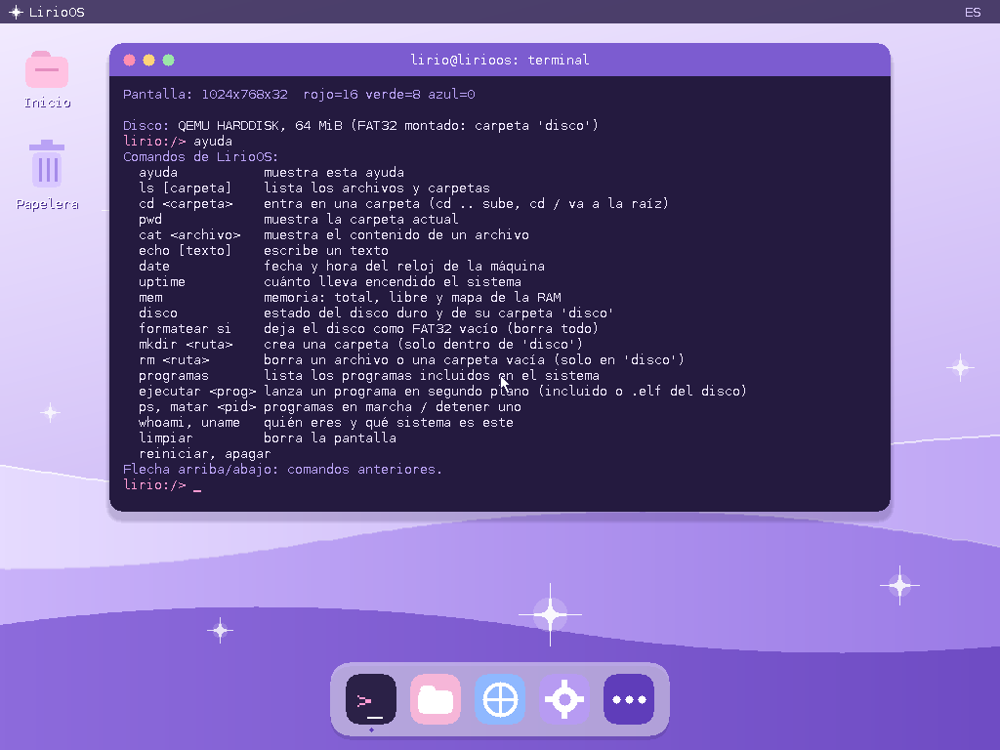

# Kernel de LirioOS

Kernel propio, escrito en C y ensamblador para x86 de 32 bits. Arranca con GRUB (Multiboot) y le pide un modo gráfico de 1024x768 con 32 bits de color.



*Captura real del kernel arrancando en QEMU, generada automáticamente por el flujo de GitHub en cada cambio (carpeta `capturas/`).*

## Qué hace hoy

- Interfaz gráfica: fondo morado con olas y destellos, barra superior, iconos de escritorio, dock inferior y un terminal dentro de una ventana.
- Teclado **en español**: ñ, Ñ, ç, ¿ ¡, tildes y diéresis con las teclas muertas, Shift, Bloq Mayús y AltGr (`@ # | ~ { } [ ] \`).
- Sistema de archivos **en memoria** (ramfs) con tres archivos de ejemplo.
- Terminal con los comandos `ayuda`, `ls`, `cat`, `echo`, `limpiar`, `about`, `reiniciar` y `apagar` (también valen `help`, `clear`, `reboot` y `halt`).

## Archivos

| Archivo | Contenido |
|---------|-----------|
| `boot.asm` | Cabecera Multiboot (pide el modo gráfico) y punto de entrada |
| `kernel.c` | Teclado, ramfs, terminal y arranque |
| `gui.h` | Dibujo: framebuffer, fondo, dock, ventana y consola |
| `font.h` | Fuente 8x16 Latin-1 generada a partir de DejaVu Sans Mono (licencia libre) |
| `gui_preview.c` | Genera una imagen del escritorio en un PC normal |

## Compilar y probar

```
make          # genera lirioos-kernel.bin
make iso      # genera LirioOS-kernel.iso (necesita grub-mkrescue y xorriso)
make run      # arranca la ISO en QEMU, si lo tienes instalado
```

Sin instalar nada, ejecuta el flujo **Compilar kernel de LirioOS** en la pestaña Actions y descarga `LirioOS-kernel-iso`.
Para probarlo en VirtualBox: máquina nueva "Other/Unknown", sin disco, con esa ISO en la unidad óptica. La pantalla debe quedar en 1024x768.

## Hoja de ruta

1. Ratón PS/2 y ventanas movibles.
2. Interrupciones (IDT, PIC, temporizador y teclado).
3. Memoria: mapa de memoria de Multiboot y un asignador sencillo.
4. Disco (ATA) y lectura de FAT32.
5. Procesos y modo usuario.
