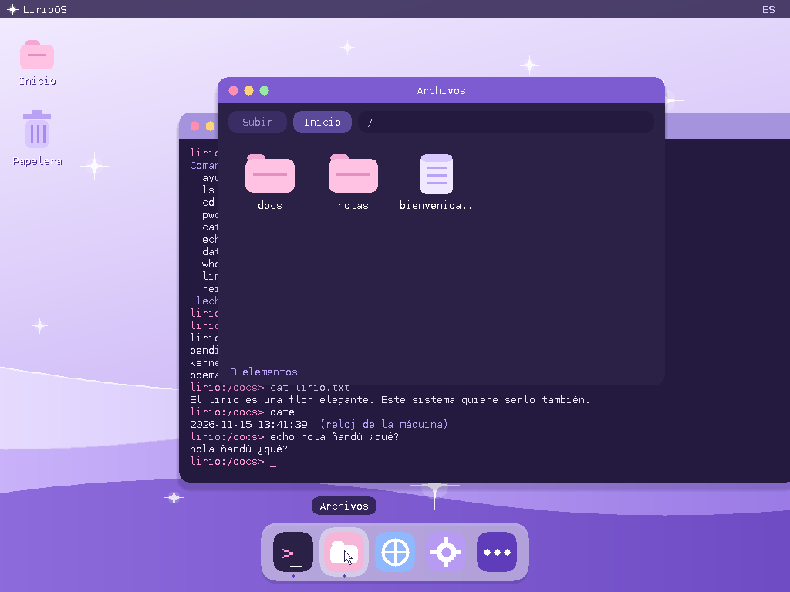

# Kernel de LirioOS

Kernel propio, escrito en C y ensamblador para x86 de 32 bits. Arranca con GRUB (Multiboot) y le pide un modo gráfico de 1024x768 con 32 bits de color.




*Captura real del kernel arrancando en QEMU, generada automáticamente por el flujo de GitHub en cada cambio (carpeta `capturas/`).*

## Qué hace hoy

- Interfaz gráfica: fondo morado con olas y destellos, barra superior, iconos de escritorio, dock inferior y un terminal dentro de una ventana.
- **Ratón PS/2** con cursor propio, todo dibujado fuera de pantalla para que no parpadee:
  - arrastrar ventanas por la barra de título;
  - botones de la ventana: rojo y amarillo la esconden, verde la centra;
  - **dock con clic**: el icono del terminal lo esconde o lo trae al frente; Archivos, Navegador, Ajustes y Más abren una ventana de aplicación (de momento "Próximamente"); aparece su nombre al pasar el ratón y un punto bajo las aplicaciones abiertas;
  - dos ventanas con orden de capas: la que pulsas pasa delante.
- Teclado **en español**: ñ, Ñ, ç, ¿ ¡, tildes y diéresis con las teclas muertas, Shift, Bloq Mayús, AltGr (`@ # | ~ { } [ ] \`) y flechas arriba/abajo para repetir comandos.
- Sistema de archivos **en memoria** (ramfs) con carpetas: `bienvenida.txt` y `docs/`.
- Terminal con `ayuda`, `ls [carpeta]`, `cd <carpeta>` (`..` y `/` también), `pwd`, `cat <archivo>`, `echo`, `date` (reloj de la máquina), `whoami`, `uname`, `limpiar`, `reiniciar` y `apagar`. Si te equivocas de comando, sugiere el correcto; los comandos de Linux (`sudo`, `apt`…) explican que LirioOS no es Linux.

## Archivos

| Archivo | Contenido |
|---------|-----------|
| `boot.asm` | Cabecera Multiboot (pide el modo gráfico) y punto de entrada |
| `kernel.c` | Teclado, ratón, ramfs, terminal y arranque |
| `gui.h` | Dibujo: pantalla, fondo, dock, ventanas, consola, cursor y ratón |
| `font.h` | Fuente 8x16 Latin-1 generada a partir de DejaVu Sans Mono (licencia libre) |
| `gui_preview.c` | Genera una imagen del escritorio en un PC normal |

## Compilar y probar

```
make          # genera lirioos-kernel.bin
make iso      # genera LirioOS-kernel.iso (necesita grub-mkrescue y xorriso)
make run      # arranca la ISO en QEMU, si lo tienes instalado
```

Sin instalar nada, ejecuta el flujo **Compilar kernel de LirioOS** en la pestaña Actions y descarga `LirioOS-kernel-iso`.
Para probarlo en VirtualBox: máquina nueva "Other/Unknown", sin disco, con esa ISO en la unidad óptica. La pantalla debe quedar en 1024x768.

## Hoja de ruta

1. Aplicaciones reales dentro de las ventanas: explorador de archivos, visor de imágenes y editor de texto (los iconos del dock ya están).
2. Interrupciones (IDT, PIC, temporizador, teclado y ratón) en lugar de consultar en bucle.
3. Memoria: mapa de memoria de Multiboot y un asignador sencillo.
4. Disco (ATA) y lectura de FAT32; después crear y borrar archivos.
5. Procesos y modo usuario.
6. Más adelante, y mucho más grande: red, audio, USB (cámara), un navegador y compatibilidad con programas de Linux.
