# Kernel de LirioOS

Kernel propio, escrito en C y ensamblador para x86 de 32 bits. Arranca con GRUB (Multiboot) y le pide un modo gráfico de 1024x768 con 32 bits de color.

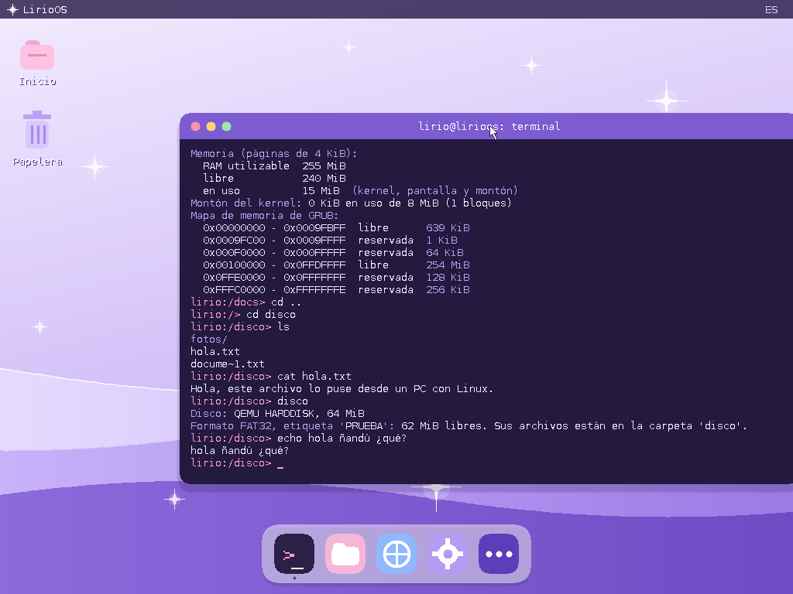


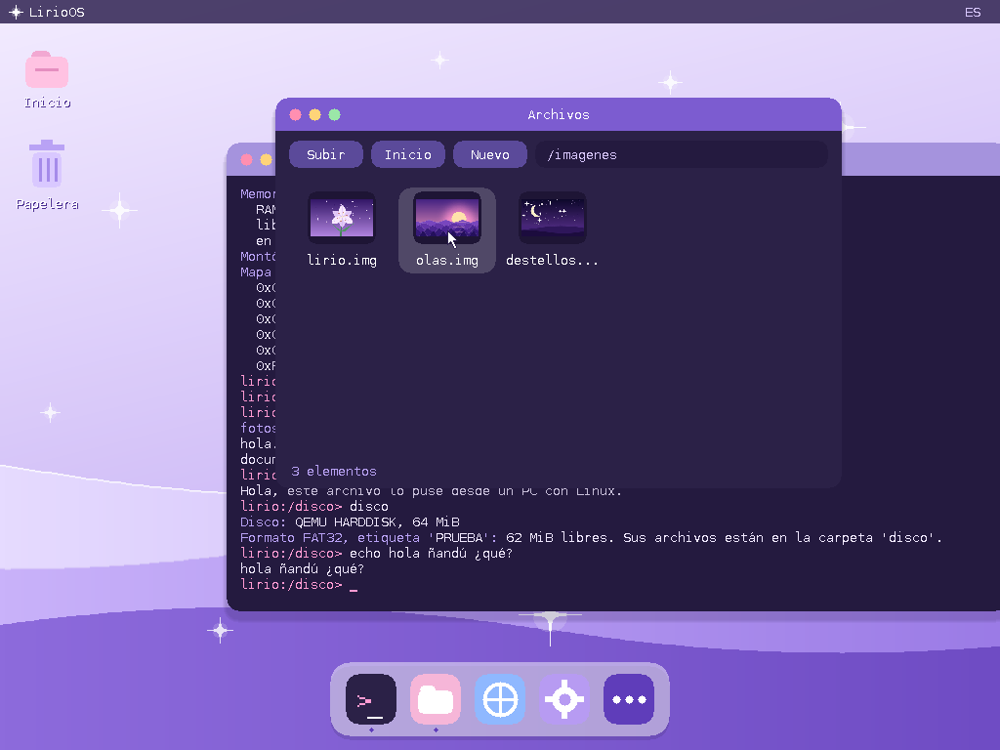

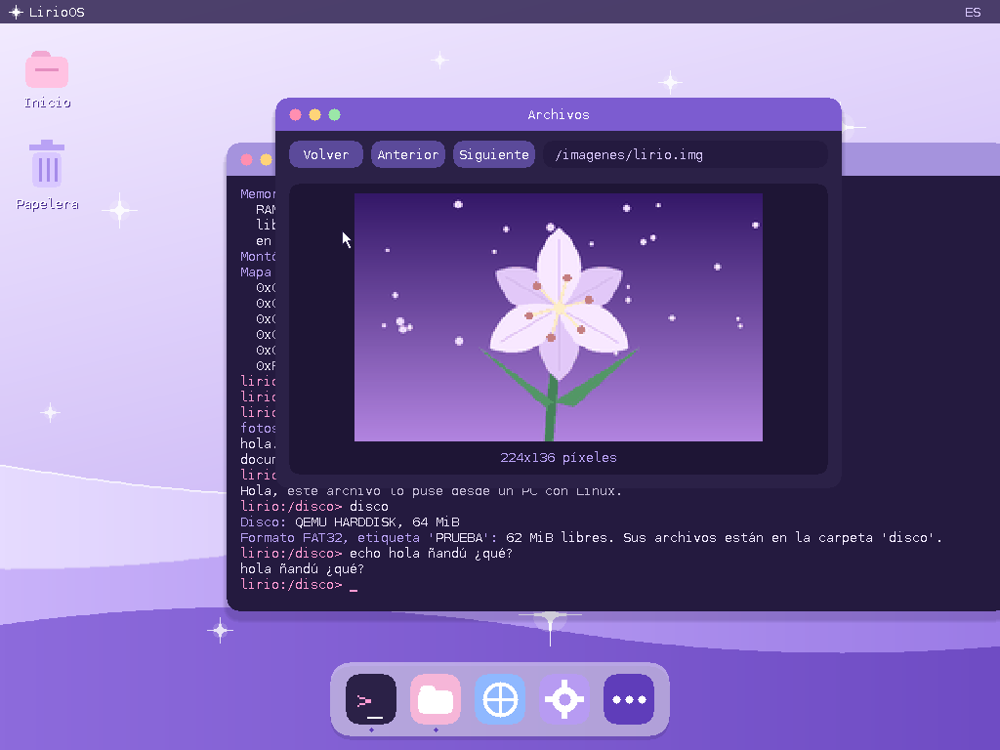


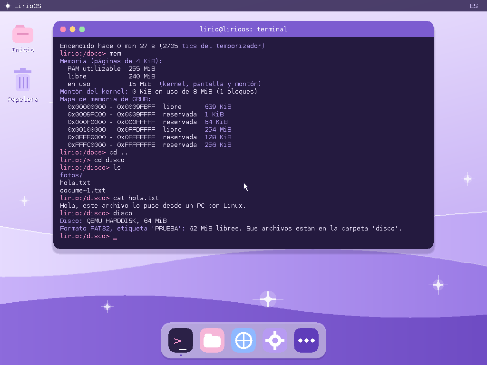

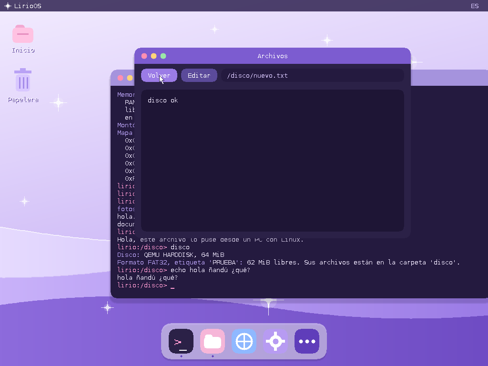

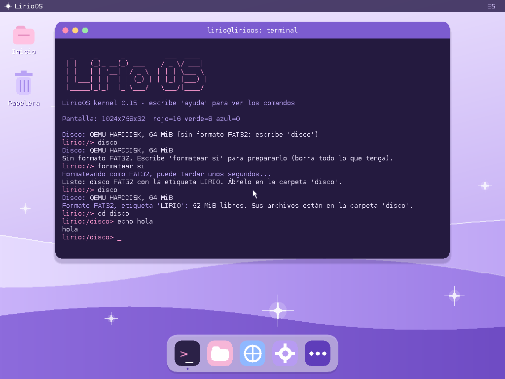

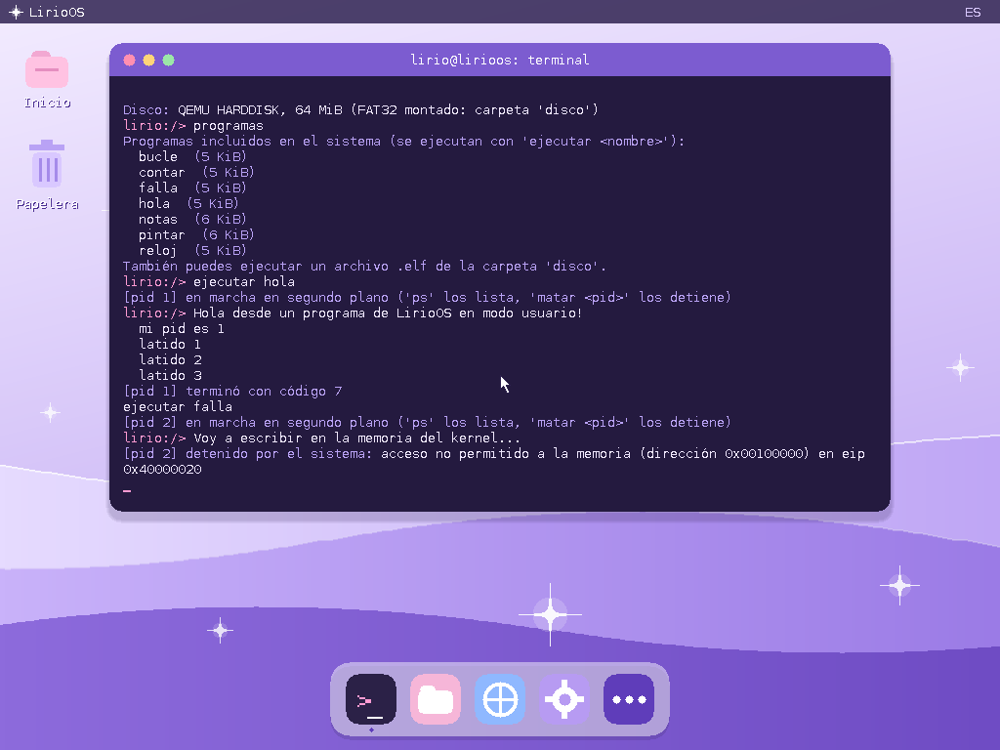

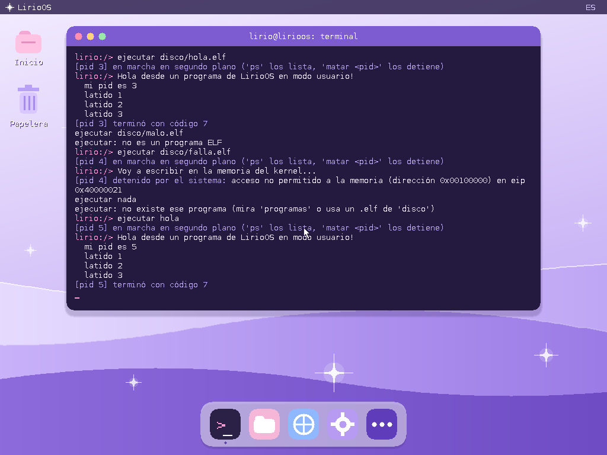

*Captura real del kernel arrancando en QEMU, generada automáticamente por el flujo de GitHub en cada cambio (carpeta `capturas/`).*

## Qué hace hoy

- Interfaz gráfica: fondo morado con olas y destellos, barra superior, iconos de escritorio, dock inferior y un terminal dentro de una ventana.
- **Ratón PS/2** con cursor propio, todo dibujado fuera de pantalla para que no parpadee:
  - arrastrar ventanas por la barra de título;
  - botones de la ventana: rojo y amarillo la esconden, verde la centra;
  - **dock con clic**: el icono del terminal lo esconde o lo trae al frente; Archivos abre el explorador y Navegador, Ajustes y Más abren una ventana "Próximamente"; aparece su nombre al pasar el ratón y un punto bajo las aplicaciones abiertas;
  - dos ventanas con orden de capas: la que pulsas pasa delante.
- **Explorador de archivos** gráfico (dock → Archivos, o el icono Inicio del escritorio): carpetas y archivos como iconos, botones Subir, Inicio y Volver, barra con la ruta, resalte al pasar el ratón y visor de texto en la misma ventana. Se abre con **doble clic** (un clic selecciona); los botones, con un clic.
- **Galería de imágenes** (Archivos → `imagenes`): miniaturas en la cuadrícula, visor con la imagen ajustada a la ventana y botones **Anterior** y **Siguiente**. Las imágenes de ejemplo (un lirio, olas con sol y un cielo de destellos) están dibujadas con código por `tools/gen_images.py` y se guardan con paleta de 256 colores.
- **Editor de texto** dentro de Archivos: **Editar** abre un `.txt`, **Nuevo** crea `nuevo.txt` (o `nuevo2.txt`…), con teclado español (ñ, tildes), Retorno y Borrar; **Guardar** escribe el archivo y **Cancelar** lo descarta. Los archivos creados o editados caben hasta 4000 bytes, se guardan en el montón del kernel y **se pierden al apagar** (el disco llegará más adelante). Con mucho texto, la vista se desplaza para mostrar el final. El cursor está siempre al final del texto: aún no hay flechas izquierda/derecha.
- **Interrupciones**: el kernel configura la tabla de interrupciones (IDT), reprograma el PIC y atiende tres: el **reloj** (PIT a 100 Hz), el **teclado** (IRQ 1) y el **ratón** (IRQ 12). Los dos últimos guardan cada byte en una cola de 256 entradas, así no se pierde ningún movimiento aunque el kernel esté dibujando; el bucle principal los procesa y, si no hay nada que hacer, duerme (`hlt`) hasta la siguiente interrupción. Se mantiene además una lectura de seguridad por sondeo, por si alguna máquina virtual no entrega una interrupción. El reloj da el doble clic, el comando `uptime` y el cursor parpadeante del editor.
- **Disco duro y FAT32** (`ata.h`, `fat.h`): el kernel busca un disco ATA (IDE) en los cuatro sitios posibles, lo lee y lo escribe sin interrupciones (PIO, LBA de 28 bits) y entiende **FAT32**. Si el disco tiene un volumen FAT32, aparece la carpeta **`disco`** en la raíz, tanto en Archivos como en el terminal (`cd disco`, `ls`, `cat`). Puedes leer archivos, **crearlos y editarlos** (Archivos > Nuevo / Editar > Guardar, con los datos guardados de verdad), crear carpetas con `mkdir`, borrar con `rm` y ver el estado con `disco`. Un disco nuevo se prepara con **`formatear si`**, que escribe un FAT32 completo (sector de arranque y su copia, FSInfo, dos tablas FAT y raíz). Límites: nombres cortos 8.3 en mayúsculas (los nombres largos de otros sistemas se ven con su nombre corto `docume~1.txt`), sin fechas de acceso reales salvo la del reloj de la máquina, archivos de hasta 4000 bytes en el editor y sin imágenes en el disco todavía. Las escrituras llegan al disco antes de volver (no hay caché de escritura); aun así, no apagues en mitad de un guardado.
- **Gestión de memoria** (`mem.h`): lee el mapa de memoria que entrega GRUB, lleva un bit por cada página física de 4 KiB (reservando los primeros MiB, el kernel y las estructuras de arranque) y reserva un **montón** de hasta 8 MiB con `kmalloc` / `kfree` (primer hueco libre, partición de bloques y unión de vecinos libres). El sistema de archivos ya no usa huecos fijos: guarda rutas y textos en ese montón y los libera al reescribirlos. El comando `mem` muestra la RAM total, libre, el montón y el mapa de GRUB.
- Teclado **en español**: ñ, Ñ, ç, ¿ ¡, tildes y diéresis con las teclas muertas, Shift, Bloq Mayús, AltGr (`@ # | ~ { } [ ] \`) y flechas arriba/abajo para repetir comandos.
- Sistema de archivos **en memoria** (ramfs) con carpetas y archivos escribibles: `bienvenida.txt`, `docs/`, `notas/` e `imagenes/`.
- Terminal con `ayuda`, `ls [carpeta]`, `cd <carpeta>` (`..` y `/` también), `pwd`, `cat <archivo>`, `echo`, `date` (reloj de la máquina), `uptime`, `mem`, `disco`, `formatear si`, `mkdir`, `rm`, `whoami`, `uname`, `limpiar`, `reiniciar` y `apagar`. Si te equivocas de comando, sugiere el correcto; los comandos de Linux (`sudo`, `apt`…) explican que LirioOS no es Linux.

## Archivos

| Archivo | Contenido |
|---------|-----------|
| `boot.asm` | Cabecera Multiboot (pide el modo gráfico) y punto de entrada |
| `kernel.c` | Teclado, ratón, ramfs, terminal y arranque |
| `gui.h` | Dibujo: pantalla, fondo, dock, ventanas, consola, cursor, ratón y explorador |
| `io.h` | Puertos de entrada/salida del procesador |
| `ata.h` | Controlador de disco ATA (IDE) por PIO |
| `fat.h` | Sistema de archivos FAT32: montar, leer, escribir, carpetas, borrar y formatear |
| `proc.h` | Modo usuario: GDT y TSS, paginación, espacios de memoria por programa, excepciones, llamadas al sistema (`int 0x80`) y lanzador de programas |
| `elf.h` | Lector y verificador de ejecutables ELF de 32 bits |
| `progs.h` | Programas de usuario incluidos en el kernel (generado por `tools/embed.py`) |
| `mem.h` | Mapa de memoria, páginas físicas y montón (`kmalloc`/`kfree`) |
| `fs.h` | Sistema de archivos en memoria (carpetas y archivos, editables, guardados en el montón) |
| `images.h` | Imágenes de ejemplo (generado por `tools/gen_images.py`, no editar a mano) |
| `font.h` | Fuente 8x16 Latin-1 generada a partir de DejaVu Sans Mono (licencia libre) |
| `gui_preview.c` | Genera una imagen del escritorio en un PC normal |

## Programas, modo usuario y multitarea (0.14)

El kernel ya puede ejecutar programas **fuera del kernel**, en el anillo 3 del procesador. Cada programa recibe su propia memoria privada (0x40000000-0x403FFFFF) mediante paginación y no puede leer ni escribir la del kernel: si lo intenta, el procesador lanza una excepción y el kernel lo detiene sin caerse (`ejecutar falla` lo demuestra). Los programas son ejecutables **ELF de 32 bits**, el mismo formato que usa Linux.

- `programas` lista los programas incluidos (`hola`, `falla`, `contar`, `bucle` y `notas`, código en `user/`).
- `ejecutar hola` ejecuta uno incluido; `ejecutar disco/hola.elf` carga un `.elf` de la carpeta `disco`.
- Llamadas al sistema (`int 0x80`, número en `eax`, argumentos en `ebx`/`ecx`/`edx`): 1 `salir`, 2 `escribir`, 3 `ticks`, 4 `dormir`, 5 `pid`, 6 `leer_tecla`, 7 `leer_archivo`, 8 `escribir_archivo`, 9 `pedir_memoria` (sbrk). Los programas se escriben sin libc con `user/lirio.h`; mira `user/hola.c`.
- Para crear uno nuevo: añade `user/miprograma.c`, ejecuta `make progs` dentro de `kernel/` y vuelve a compilar el kernel.

**Multitarea:** `ejecutar` lanza el programa **en segundo plano** y el terminal queda libre. Se pueden tener hasta 7 a la vez. El temporizador (100 veces por segundo) reparte el procesador por turnos entre los programas y el escritorio (que es el proceso 0), así que un programa que no para nunca (`ejecutar bucle`) no congela nada. `ps` lista los programas en marcha y `matar <pid>` detiene uno. Mientras un programa está dentro del kernel (una llamada al sistema) no se le quita el procesador, así los datos del kernel no se corrompen; al dormirse (`dormir`) sí cede el turno. `ejecutar contar` dos veces muestra dos contadores mezclados.

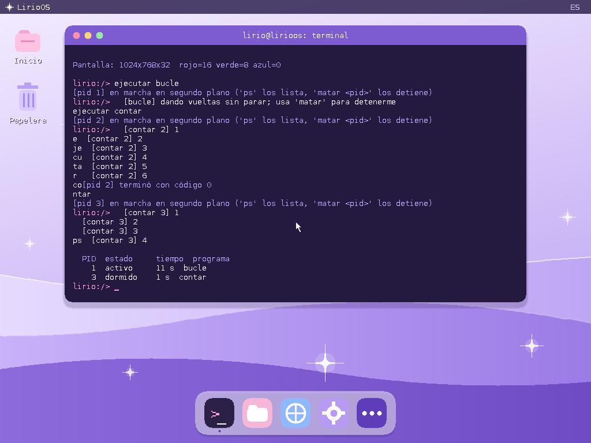

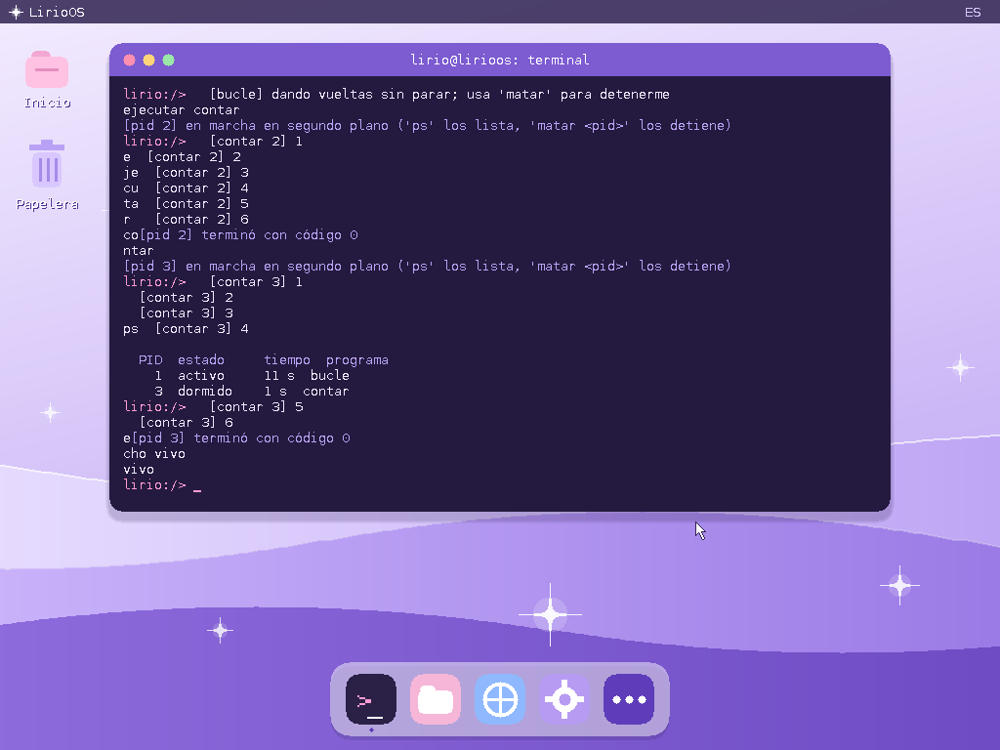

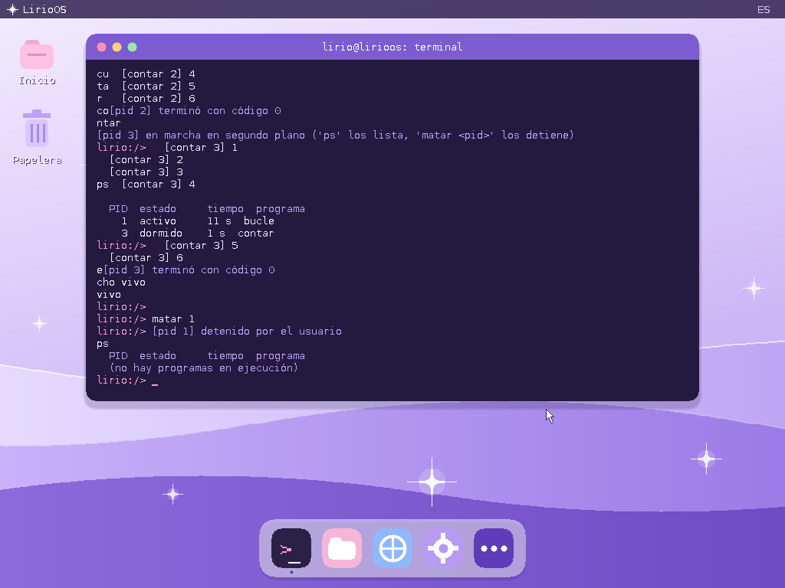

**Teclado, archivos y memoria:** un programa que llama a `leer_tecla` recibe el teclado en lugar del terminal (Esc lo detiene). Puede leer y escribir archivos, también del disco, y pedir memoria al sistema. `ejecutar notas` lo demuestra: pide una nota, la guarda en `disco/notas.txt` y la vuelve a leer.

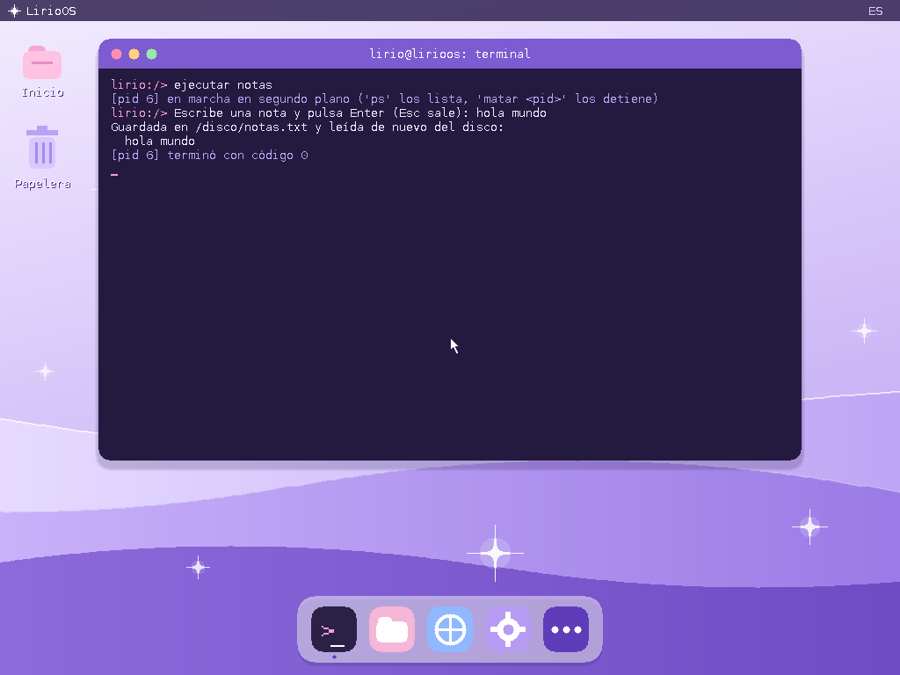

Límites: solo se usa el primer GiB de RAM y los programas son estáticos (sin librerías dinámicas). Esto no es todavía compatibilidad con Linux ni con `.exe`: los programas tienen que estar hechos para las llamadas de LirioOS.

## Compilar y probar

```
make          # genera lirioos-kernel.bin
make iso      # genera LirioOS-kernel.iso (necesita grub-mkrescue y xorriso)
make run      # arranca la ISO en QEMU, si lo tienes instalado
```

Sin instalar nada, ejecuta el flujo **Compilar kernel de LirioOS** en la pestaña Actions y descarga `LirioOS-kernel-iso`.
Para probarlo en VirtualBox: máquina nueva "Other/Unknown" con esa ISO en la unidad óptica. La pantalla debe quedar en 1024x768.
Para probar el disco: en Almacenamiento añade un **disco duro** nuevo (VDI, unos 64 MiB bastan) al controlador **IDE (PIIX4)**. Al arrancar el kernel lo detecta; escribe `formatear si` una vez y ya tendrás la carpeta `disco`. Un disco FAT32 hecho en otro sistema también vale.

`tools/check_fat32.py imagen.img -t` es un verificador independiente de imágenes FAT32 (lo usa el CI para comprobar lo que escribe el kernel).

## Hoja de ruta

1. Más aplicaciones reales (el explorador, el visor de imágenes y el editor ya existen): reproductor, ajustes.
2. Ventanas gráficas para los programas (hoy solo escriben en el terminal) y más llamadas al sistema.
3. Más adelante, y mucho más grande: red, audio, USB (cámara), un navegador y compatibilidad con programas de Linux.
