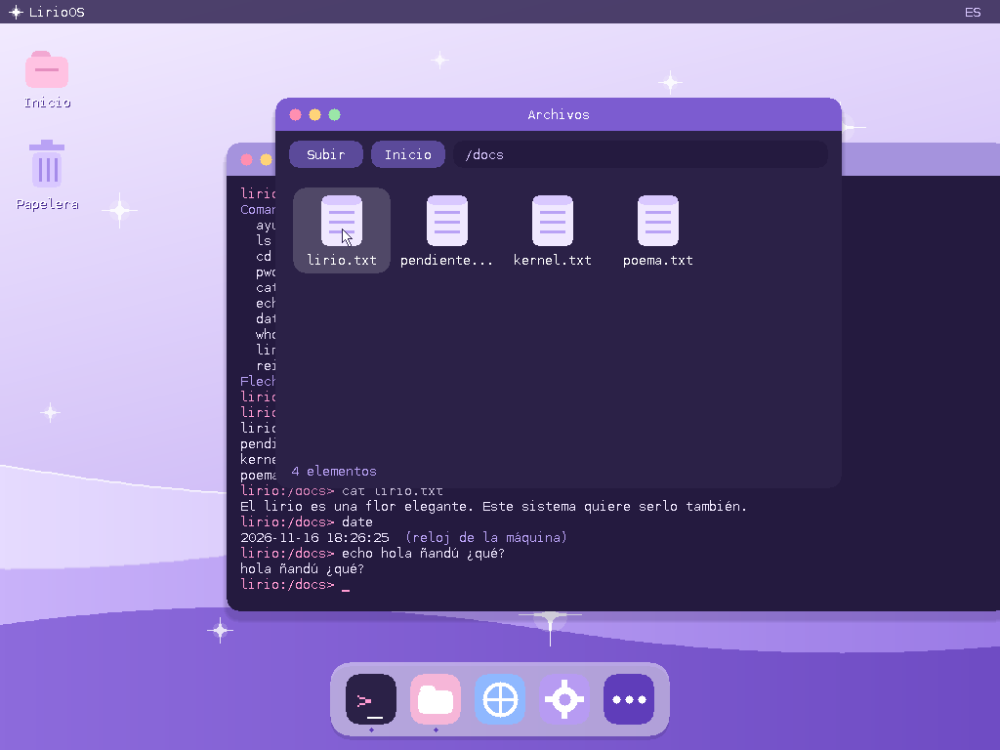
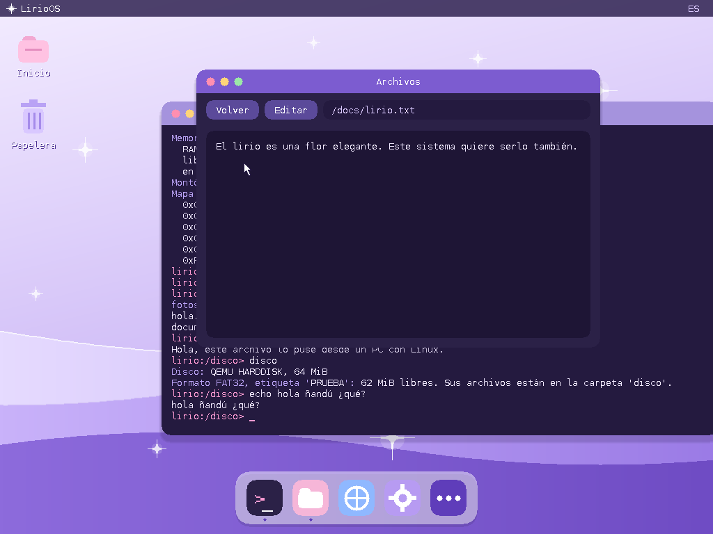
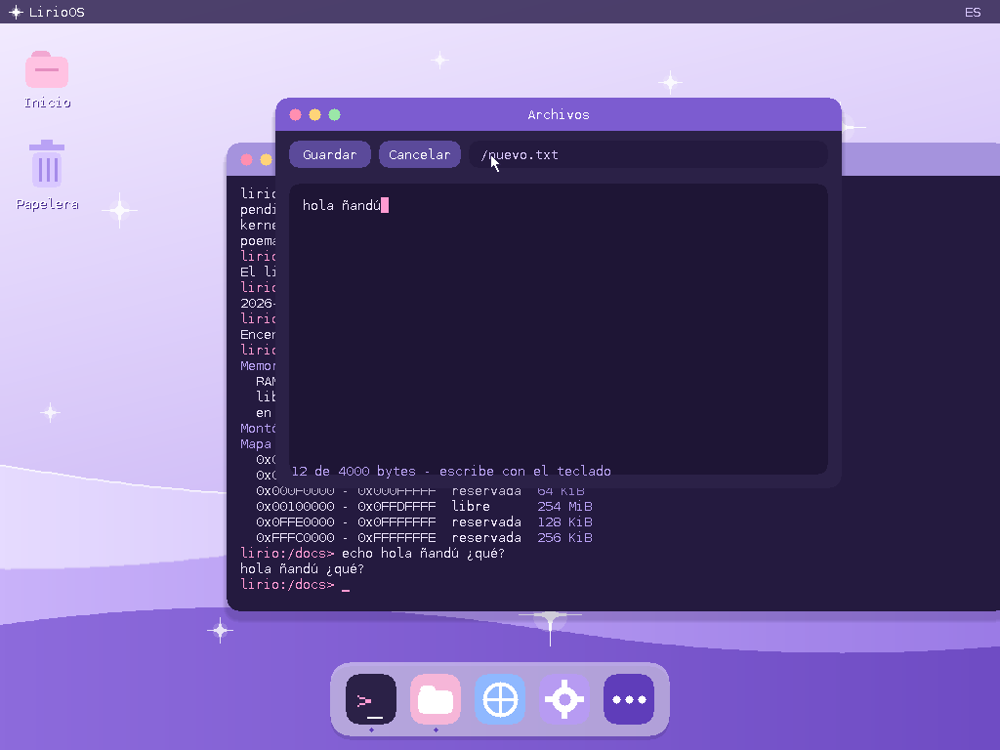

# Kernel de LirioOS

Kernel propio, escrito en C y ensamblador para x86 de 32 bits. Arranca con GRUB (Multiboot) y le pide un modo gráfico de 1024x768 con 32 bits de color.









*Captura real del kernel arrancando en QEMU, generada automáticamente por el flujo de GitHub en cada cambio (carpeta `capturas/`).*

## Qué hace hoy

- Interfaz gráfica: fondo morado con olas y destellos, barra superior, iconos de escritorio, dock inferior y un terminal dentro de una ventana.
- **Ratón PS/2** con cursor propio, todo dibujado fuera de pantalla para que no parpadee:
  - arrastrar ventanas por la barra de título;
  - botones de la ventana: rojo y amarillo la esconden, verde la centra;
  - **dock con clic**: el icono del terminal lo esconde o lo trae al frente; Archivos abre el explorador y Navegador, Ajustes y Más abren una ventana "Próximamente"; aparece su nombre al pasar el ratón y un punto bajo las aplicaciones abiertas;
  - dos ventanas con orden de capas: la que pulsas pasa delante.
- **Explorador de archivos** gráfico (dock → Archivos, o el icono Inicio del escritorio): carpetas y archivos como iconos, botones Subir, Inicio y Volver, barra con la ruta, resalte al pasar el ratón y visor de texto en la misma ventana. Se abre con **doble clic** (un clic selecciona); los botones, con un clic.
- **Galería de imágenes** (Archivos → `imagenes`): miniaturas en la cuadrícula, visor con la imagen ajustada a la ventana y botones **Anterior** y **Siguiente**. Las imágenes de ejemplo (un lirio, olas con sol y un cielo de destellos) están dibujadas con código por `tools/gen_images.py` y se guardan con paleta de 256 colores.
- **Editor de texto** dentro de Archivos: **Editar** abre un `.txt`, **Nuevo** crea `nuevo.txt` (o `nuevo2.txt`…), con teclado español (ñ, tildes), Retorno y Borrar; **Guardar** escribe el archivo y **Cancelar** lo descarta. Los archivos creados o editados caben hasta 4000 bytes, se guardan en el montón del kernel y **se pierden al apagar** (el disco llegará más adelante). Con mucho texto, la vista se desplaza para mostrar el final. El cursor está siempre al final del texto: aún no hay flechas izquierda/derecha.
- **Interrupciones**: el kernel configura la tabla de interrupciones (IDT), reprograma el PIC y atiende tres: el **reloj** (PIT a 100 Hz), el **teclado** (IRQ 1) y el **ratón** (IRQ 12). Los dos últimos guardan cada byte en una cola de 256 entradas, así no se pierde ningún movimiento aunque el kernel esté dibujando; el bucle principal los procesa y, si no hay nada que hacer, duerme (`hlt`) hasta la siguiente interrupción. Se mantiene además una lectura de seguridad por sondeo, por si alguna máquina virtual no entrega una interrupción. El reloj da el doble clic, el comando `uptime` y el cursor parpadeante del editor.
- **Gestión de memoria** (`mem.h`): lee el mapa de memoria que entrega GRUB, lleva un bit por cada página física de 4 KiB (reservando los primeros MiB, el kernel y las estructuras de arranque) y reserva un **montón** de hasta 8 MiB con `kmalloc` / `kfree` (primer hueco libre, partición de bloques y unión de vecinos libres). El sistema de archivos ya no usa huecos fijos: guarda rutas y textos en ese montón y los libera al reescribirlos. El comando `mem` muestra la RAM total, libre, el montón y el mapa de GRUB.
- Teclado **en español**: ñ, Ñ, ç, ¿ ¡, tildes y diéresis con las teclas muertas, Shift, Bloq Mayús, AltGr (`@ # | ~ { } [ ] \`) y flechas arriba/abajo para repetir comandos.
- Sistema de archivos **en memoria** (ramfs) con carpetas y archivos escribibles: `bienvenida.txt`, `docs/`, `notas/` e `imagenes/`.
- Terminal con `ayuda`, `ls [carpeta]`, `cd <carpeta>` (`..` y `/` también), `pwd`, `cat <archivo>`, `echo`, `date` (reloj de la máquina), `uptime`, `mem`, `whoami`, `uname`, `limpiar`, `reiniciar` y `apagar`. Si te equivocas de comando, sugiere el correcto; los comandos de Linux (`sudo`, `apt`…) explican que LirioOS no es Linux.

## Archivos

| Archivo | Contenido |
|---------|-----------|
| `boot.asm` | Cabecera Multiboot (pide el modo gráfico) y punto de entrada |
| `kernel.c` | Teclado, ratón, ramfs, terminal y arranque |
| `gui.h` | Dibujo: pantalla, fondo, dock, ventanas, consola, cursor, ratón y explorador |
| `mem.h` | Mapa de memoria, páginas físicas y montón (`kmalloc`/`kfree`) |
| `fs.h` | Sistema de archivos en memoria (carpetas y archivos, editables, guardados en el montón) |
| `images.h` | Imágenes de ejemplo (generado por `tools/gen_images.py`, no editar a mano) |
| `font.h` | Fuente 8x16 Latin-1 generada a partir de DejaVu Sans Mono (licencia libre) |
| `gui_preview.c` | Genera una imagen del escritorio en un PC normal |

## Compilar y probar

```
make          # genera lirioos-kernel.bin
make iso      # genera LirioOS-kernel.iso (necesita grub-mkrescue y xorriso)
make run      # arranca la ISO en QEMU, si lo tienes instalado
```

Sin instalar nada, ejecuta el flujo **Compilar kernel de LirioOS** en la pestaña Actions y descarga `LirioOS-kernel-iso`.
Para probarlo en VirtualBox: máquina nueva "Other/Unknown", sin disco, con esa ISO en la unidad óptica. La pantalla debe quedar en 1024x768.

## Hoja de ruta

1. Más aplicaciones reales (el explorador, el visor de imágenes y el editor ya existen): reproductor, ajustes.
2. Disco (ATA) y lectura de FAT32; después crear y borrar archivos.
3. Procesos y modo usuario.
4. Más adelante, y mucho más grande: red, audio, USB (cámara), un navegador y compatibilidad con programas de Linux.
